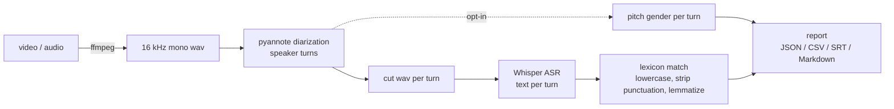

# profanity-diarization

Find profanity in movie clips and videos and say **who said it and when**, using
[Whisper](https://github.com/openai/whisper) (speech-to-text) and
[pyannote.audio](https://github.com/pyannote/pyannote-audio) (speaker diarization).
After a one-time model download, inference runs locally with no network.

This is a clean, tested reimplementation of the system described in:

> R. S. Baath, K. R. Meesala, J. U. Garad, S. Sahane, S. Bobde, U. Tiwari,
> *An Offline Modular System for Profanity Detection and Speaker Diarization in Movies and Video Clips
> Using Whisper and PyAnnote*, IJFMR 7(3), May-June 2025. <https://doi.org/g9kfph>

The `paper` preset reproduces the published behaviour. Everything that goes beyond it is **opt-in** and
lives in separate presets, so the original method stays measurable. This README reports what was
actually run, including where the original method falls short.

> **Content note.** Profane terms are masked (`f***`) in all documentation and in the Markdown/SRT
> reports. Only the raw JSON/CSV produced on your machine contain the real words.

## Status at a glance

| | |
|---|---|
| Pipeline (audio -> diarize -> transcribe -> detect -> report) | Working, run end-to-end on 3 inputs (CPU, Windows) |
| Tests | 29 pass in ~1.5 s, no network / GPU / model downloads needed |
| Matches the legacy script's output exactly | **Not verified**: the fidelity script is not written yet |
| Paper's reported 94.8% accuracy / 93.4% F1 | **Not reproducible** from the original files (no evaluation code or labels exist) |
| Gender labels of the paper rule | **Unreliable**: they come from a speaker-label rule, not from voices (see below) |
| Real-audio accuracy of the new gender classifier | **Not yet measured**: needs hand labels ([how](#gender-the-open-item)) |

## How it works



Stages are cached on disk keyed by input hash + stage config, so reruns and report changes are fast
(re-reporting a cached 6.5-minute video took 9-17 s, versus many minutes for a fresh run on CPU).

The paper pipeline is *diarize first, then transcribe each speaker turn separately*. It keeps **no word
timestamps**: a hit carries the start/end of the turn it occurred in.

## Quickstart

Requirements: Python 3.9+, [ffmpeg](https://ffmpeg.org) on `PATH`, ~4 GB free RAM, a Hugging Face account.

```bash
git clone <repo-url> && cd profanity-diarization
python -m venv .venv
.venv/Scripts/activate            # Windows;  source .venv/bin/activate on Linux/macOS
pip install -e ".[models,dev]"    # torch, openai-whisper, pyannote.audio, nltk, ...
```

**Hugging Face access (required once).** The pyannote models are gated. While logged in, open each page
and click *Agree and access repository*:

- <https://huggingface.co/pyannote/speaker-diarization> and <https://huggingface.co/pyannote/segmentation> (`paper`)
- <https://huggingface.co/pyannote/speaker-diarization-3.1> and <https://huggingface.co/pyannote/segmentation-3.0> (`improved31`)

Create a read token at <https://huggingface.co/settings/tokens> and put it in a git-ignored `.env`:

```
HF_TOKEN=hf_xxxxxxxx
```

```bash
profanity-diarization prefetch-models          # one-time downloads (Whisper, pyannote, WordNet)
profanity-diarization process clip.mp4 --output-dir output
profanity-diarization process clip.mp4 --preset improved --output-dir output_improved
```

Outputs per input in `--output-dir`: `<name>.json` (canonical), `.csv` (hits), `.srt` (speaker-labelled,
masked), `.md` (summary, masked). `python -m profanity_diarization.cli ...` works too.

> The first model run is slow on CPU. Measured here (CPU only, Whisper `small`, original diarizer): about
> 7 minutes for a 2-minute clip. Use `--device cuda` if you have a CUDA build of torch.

## Presets

| Preset | Diarizer | Matching | Speaker labels | Purpose |
|---|---|---|---|---|
| `paper` (default) | `pyannote/speaker-diarization` | exact set match on lemmatized token | `SPEAKER_01` -> FEMALE rule | Faithful to the published code (`final_gpu.py`) |
| `legacy_v1` | same | exact, **no lemmatization**, earlier lexicon | same | The earlier `final.py` scripts |
| `improved` | same | + stem matching with stoplist, + whole-phrase matching | per-turn voice pitch | Opt-in fixes, original diarizer |
| `improved31` | `pyannote/speaker-diarization-3.1` | as `improved` | as `improved` | `improved` with the newer diarizer |

Presets are YAML in `src/profanity_diarization/presets/`; `--preset path/to/my.yaml` also works.

### Config reference

| Key | Values | Meaning |
|---|---|---|
| `whisper_model` | `tiny`...`large` | Whisper size (`small` in the paper) |
| `language` | `en` / null | Forced language (`en` in the paper); null = auto |
| `diarization_model` | HF repo id | pyannote pipeline |
| `lexicon` | null / name / path | null = bundled 20-term list; a bare name picks a bundled file |
| `lemmatize` | bool | WordNet verb lemmatization before matching (paper: true) |
| `match` | `exact` / `improved` | `improved` adds stems, stoplist, phrases |
| `speaker_labels` | `paper_gender` / `pitch_gender` / `raw` | How turns are grouped (see below) |

### CLI

| Command | What it does |
|---|---|
| `process FILE` | One video/audio file. Options: `--preset`, `--output-dir`, `--device auto\|cpu\|cuda`, `--offline`, `--keep-intermediate` |
| `batch DIR` | Every media file in a directory (models loaded once). Same options. Exit code 1 if any file failed |
| `prefetch-models` | One-time download of Whisper, pyannote and WordNet; prints cache locations |
| `report JSON` | Re-render CSV / SRT / Markdown from a saved JSON report |

## Example output

Produced by the `improved` preset on a synthetic text-to-speech clip written for this repo (so it can be shown):

```
- 00:00:00,115-00:00:02,427 SPEAKER_01 (MALE): `s***` in "Oh s*** I forgot my keys again."
- 00:00:08,722-00:00:11,422 SPEAKER_01 (MALE): `b***` in "He called me a b*** in front of the whole class."
- 00:00:13,261-00:00:15,269 SPEAKER_01 (MALE): `f***` in "Get the f*** out of my office right now."
```

The Markdown report also contains a per-speaker table and a **turn audit table** (time, speaker, group,
pitch, hit count; no dialogue text) so you can check every turn against the video.

## Results

All numbers below come from runs in this repo (CPU, Whisper `small`, pyannote.audio 3.3.2, torch 2.7.1).
Raw results: `eval/results/*.json`; rendered, masked report: [`eval/results.md`](eval/results.md).
Reproduce with the commands in [Reproducing the results](#reproducing-the-results).

### Test material

| Set | Content | Length | Ground truth |
|---|---|---|---|
| Real clip 1 | A documentary-style streaming trailer | 120 s | 13 profane tokens, labelled by the model |
| Real clip 2 | A magazine video of a father and daughter | 392 s | 32 profane tokens, labelled by the model |
| Synthetic | 25 scripted sentences, 2 offline TTS voices (1 male, 1 female), includes decoys | 103 s | Exact, by construction |

The real clips are copyrighted, so they are **not** in the repo. Their labelled transcripts are kept locally
in the git-ignored `eval/data/`. Labels were assigned by the model that wrote this code, **not by
independent human annotators**; borderline calls are noted in the label files. Please audit them.
The synthetic set contains decoys on purpose: innocent words that contain a profane stem, mild lexicon
words used literally, and a person's name.

### 1. Detection: `paper` vs `improved` (token level, profane = positive)

Token-level metrics are measured on the ASR transcript. Because >98% of tokens are not profane, accuracy
is inflated by true negatives: **read precision, recall and F1 first.**

| Set | Preset | TP | FP | FN | TN | Accuracy | Precision | Recall | F1 |
|---|---|---|---|---|---|---|---|---|---|
| Real clips pooled | `paper` | 38 | 3 | 7 | 1073 | 99.1% | 92.7% | 84.4% | 88.4% |
| | `improved` | 45 | 3 | 0 | 1073 | 99.7% | 93.8% | 100% | 96.8% |
| Real clip 1 | `paper` | 10 | 0 | 3 | 261 | 98.9% | 100% | 76.9% | 87.0% |
| | `improved` | 13 | 0 | 0 | 261 | 100% | 100% | 100% | 100% |
| Real clip 2 | `paper` | 28 | 3 | 4 | 812 | 99.2% | 90.3% | 87.5% | 88.9% |
| | `improved` | 32 | 3 | 0 | 812 | 99.6% | 91.4% | 100% | 95.5% |
| Synthetic | `paper` | 10 | 4 | 5 | 186 | 95.6% | 71.4% | 66.7% | 69.0% |
| | `improved` | 15 | 4 | 0 | 186 | 98.0% | 78.9% | 100% | 88.2% |

What the errors are:

- **False negatives (`paper`)** are profane words the 20-term list cannot match: compounds and agent nouns
  (`motherf***er`, `horses***`, `f***ery`), a word that is not in the list at all, and plurals of listed words.
  `improved` catches them with stem matching.
- **False positives (both presets)** are mild or literal uses of listed words (`d***`, `h***`, `s*** over`,
  `f*** accident`) and a surname/book title. Neither preset looks at context, so `improved` does not fix these.
- `improved`'s stem matching also protects innocent words (a stoplist blocks e.g. a famous novelist's surname).

**Caveat on the numbers.** `improved` was designed after looking at real clip 1's errors, so its clip 1
score is in-sample. Real clip 2 and the synthetic set were not used to design it, but the same model
labelled the real clips. Treat the gap between `paper` and `improved` as indicative, not definitive.
The paper reports 94.8% accuracy / 93.4% F1; those figures cannot be compared with the table above because
the original evaluation data and code do not exist in the source files, and the unit of measurement differs.

### 2. Diarization: original vs `pyannote/speaker-diarization-3.1`

Both models run on the same inputs and the same Whisper `small`, differing only in the diarizer.

| Measure | Original (paper) | 3.1 |
|---|---|---|
| Real clip 1: speaker labels / turns | 3 / 15 | 3 / 30 (many turns < 1 s) |
| Real clip 1: diarization time | 360 s | 153 s (2.4x faster) |
| Real clip 1: ASR time | 70 s | 198 s (2.8x slower: more, shorter turns) |
| Real clip 1: wall time | 7 min 17 s | 5 min 59 s |
| Real clip 1: profane words present in the transcript* | 13 of 13 | **10 of 13** |
| Real clip 1: end-to-end recall, `paper` matching | 10/13 = 76.9% | 7/13 = 53.8% |
| Real clip 1: end-to-end recall, `improved` matching | 13/13 = 100% | 10/13 = 76.9% |
| Real clip 1: token-level F1, `paper` / `improved` | 87.0% / 100% | 82.4% / 100% |
| Real clip 2: speaker labels / turns | 2 / 69 (19 under 1 s) | 2 / 120 (52 under 1 s) |
| Real clip 2: diarization / ASR time | not recorded | 413 s / 435 s |
| Real clip 2: profane words present in the transcript* | 32 of 32 | 31 of 32 |
| Real clip 2: end-to-end recall, `paper` / `improved` matching | 28/32 = 87.5% / 32/32 = 100% | 27/32 = 84.4% / 31/32 = 96.9% |
| Real clip 2: token-level F1, `paper` / `improved` | 88.9% / 95.5% | 88.5% / 95.4% |
| Synthetic (known truth): speakers found / true | 2 / 2 | 2 / 2 |
| Synthetic: speaker purity | 100% | 100% |
| Synthetic: diarization time | 247 s | 113 s |
| Synthetic: turns | 25 | 27 |

\* "Present in the transcript" is counted against the profane words of the hand-labelled **original** run, so the
original column is 100% by construction. It measures what 3.1 *loses relative to the original*, not what
Whisper missed in absolute terms. "End-to-end recall" divides detected words by those same gold counts.

How to read the gap:

- **3.1 cuts the audio into more, shorter turns** (30 vs 15 on clip 1, 120 vs 69 on clip 2). Because this
  method transcribes each turn on its own, short turns give Whisper little context and words that
  straddle a boundary can be lost. The damage depends on the clip: on the fast-cut trailer 3 of 13
  profane words never reach the transcript; on the interview only 1 of 32. A word lost before the detector
  cannot be recovered by any matcher. Token-level F1 is computed on the transcript, so it barely moves
  (88.9% -> 88.5%, 95.5% -> 95.4% on clip 2); the end-to-end recall rows show the loss.
- **Speed is mixed.** 3.1 diarized the trailer 2.4x faster but its extra turns made ASR 2.8x slower, so it was
  faster overall on clip 1 (5 min 59 s vs 7 min 17 s). On clip 2 it took 413 s + 435 s (about 14 min for 392 s
  of video); the original diarizer's time on that clip was not recorded, so there is no comparison.
- **3.1 separated the two people on clip 2 correctly** (label `SPEAKER_00` = the daughter, `SPEAKER_01` = the
  father), as did the original diarizer (with the labels the other way round).
- **Neither model separated the trailer's speakers correctly.** Both return 3 labels for a clip with many
  more voices, so a label does not equal a person. On a clean two-voice synthetic clip both are perfect;
  that clip is easy and says little about real films.
- **No diarization error rate (DER) was measured** on real data: that needs reference RTTM annotations,
  which this repo does not have yet.
- **Verdict so far (two real clips, one synthetic):** no clear win for 3.1 in this per-turn design. It is
  equal or slightly worse on end-to-end recall (3 to 23 points lower depending on matcher and clip) and only
  sometimes faster. `improved` (original diarizer) stays the recommended preset; 3.1 becomes attractive if
  very short turns are merged before transcription, which is not implemented yet.

### 3. Speaker "gender": the paper rule vs voice pitch

The paper rule assigns FEMALE to a diarization label containing `SPEAKER_01` (if it is the first such label)
and MALE to everything else. It never looks at the voice. It is a coin flip that depends on which label the
diarizer happened to produce first.

On the synthetic clip (true voices known, time-weighted over speech):

| Method | Original diarizer | 3.1 diarizer |
|---|---|---|
| Paper rule (`SPEAKER_01` -> FEMALE) | **0%** (both voices inverted) | **100%** (by luck of label order) |
| Per-turn voice pitch (`pitch_gender`) | 100% | 100% |

The same rule gives opposite results on identical audio. That is the bug seen on real clip 1, where
the (male) narrator's turns were labelled FEMALE.

`pitch_gender` (in `improved` / `improved31`) estimates median pitch (F0) per turn from the audio
(threshold 165 Hz, `UNKNOWN` when too little voiced audio). It is a rough acoustic heuristic, not a trained model.

#### Gender: the open item

- 100% on the synthetic clip is the easy case (clean TTS; the female voice sits at 174-205 Hz, close to the threshold).
- On real audio it is **unvalidated**: on real clip 1, 6 of 15 turns fall at 156-172 Hz (ambiguous) and one at
  the 400 Hz search limit (music/noise). On real clip 2, where the original diarizer cleanly separated the two
  people, the paper rule happened to be right (4 FEMALE hits) and per-turn pitch moved some of the
  father's turns to FEMALE (9 FEMALE hits instead of 4), so per-turn pitch can be **worse** than the label rule when diarization is clean.
- With the 3.1 diarizer on clip 2, the daughter's label was FEMALE in 18 of 20 turns (2 `UNKNOWN`) and the
  father's was MALE in 75, FEMALE in 11 and `UNKNOWN` in 14 turns, so about 13% of the father's decided turns
  still flip. Clip 2 has no hand-checked gender labels, so none of these are accuracies.
- A speaker-smoothing variant (`gender.smooth_by_speaker`) exists but is not wired in until data says it helps.
- To measure it: open `eval/data/gender_template.csv` (created by `python -m eval.gender_eval template`), fill
  `true_gender` (M/F) for turns you can verify against the video, then run `python -m eval.gender_eval score`.
  It scores the paper rule, per-turn pitch and the smoothed variant on your labels.

## What the original system gets wrong

Found by running it, not by assumption (details in [`AUDIT.md`](AUDIT.md) and [`docs/PROGRESS.md`](docs/PROGRESS.md)):

| # | Finding | Handling |
|---|---|---|
| 1 | No word timestamps; hits only know their turn | Kept in `paper`; reported as turn-level |
| 2 | Overlapping diarization turns are transcribed twice | Kept in `paper`; not fixed yet |
| 3 | The lexicon entry for a multi-word phrase can never match (text is split on spaces) | Kept in `paper`; fixed in `improved` |
| 4 | Under verb lemmatization, two lexicon entries (`n***`, `s***s`) can never match | Kept in `paper` |
| 5 | The newer lexicon dropped one term the earlier list had (`p***`), so it is missed | Kept in `paper`; covered by `improved` stems |
| 6 | "Gender" is a label rule, not detection | Kept in `paper`; pitch variant in `improved` |
| 7 | Not actually offline on first use (WordNet + models download) | Documented below |
| 8 | A Hugging Face token was hard-coded in the original scripts | Not copied; token comes from `HF_TOKEN` only |
| 9 | Reported metrics have no code or data behind them | Re-measured here, see Results |

## Offline: what it means here

After a one-time download (`prefetch-models`: Whisper weights, pyannote pipelines, WordNet), `process`
needs **no network** (`--offline` forces this). The first run needs internet and a Hugging Face token.
The token is never stored in the repo: use an environment variable or a git-ignored `.env`.

## Limitations and responsible use

- English only (`language: en` is forced). No Hindi/Hinglish or other languages, and no claim of support.
- Lexical matching has no context: mild words used literally are flagged; euphemisms and obfuscations are missed.
- Accuracy is bounded by Whisper (it can hallucinate on silence and music) and by diarization quality.
- Not real-time. On CPU a fresh run took about 3.5x the clip length (measured on 1.7- and 2-minute clips).
- **Intended use:** content moderation, subtitling, accessibility and research on media language.
  **Not intended** for surveillance or covert profiling of individuals. Speaker-"gender" output is a
  heuristic and must not be used to make claims about real people.
- Processing someone else's media may be restricted by copyright or privacy law. This repo ships no
  copyrighted audio or video.

## Troubleshooting (real issues seen on Windows + Python 3.9)

| Symptom | Cause / fix |
|---|---|
| `RuntimeError: cannot load 'pyannote/...'` | Token missing/expired, or you have not accepted the model's terms (see Quickstart) |
| `operator torchvision::nms does not exist` | torchvision does not match torch. Install the matching pair, e.g. torch 2.7.1 with torchvision 0.22.1 / torchaudio 2.7.1 |
| `numpy.dtype size changed ... binary incompatibility` from `thinc`/`spacy` | An old system spaCy built for numpy 1.x. Use a clean venv (no system site-packages) or uninstall spaCy; pyannote only needs it optionally |
| `ffmpeg not found on PATH` | Install ffmpeg and reopen the terminal |
| Process killed silently on long runs | Low free RAM; close other apps (Whisper + pyannote need a few GB) |

## Reproducing the results

```bash
# transcripts + reports (slow on CPU; cached afterwards)
profanity-diarization process "<clip>.mp4" --preset paper    --output-dir output
profanity-diarization process "<clip>.mp4" --preset improved --output-dir output_improved
profanity-diarization process "<clip>.mp4" --preset improved31 --output-dir output_31

# synthetic clip (Windows, offline TTS) and its labels
python -m eval.synthetic audio
profanity-diarization process eval/data/synthetic.wav --preset paper --output-dir output
python -m eval.synthetic labels output/synthetic.json

# score detection, diarization (synthetic), and render the masked report
python -m eval.evaluate
python -m eval.diar_eval
python -m eval.report            # -> eval/results.md
```

Real-clip label files go in `eval/data/<name>.labels.json` (format in `eval/evaluate.py`).

## Repository layout

```
src/profanity_diarization/   audio, asr, diarize, speakers, gender, profanity, report, pipeline, cli, config, presets/, lexicon/
eval/                        metrics, evaluate, diar_eval, gender_eval, synthetic, report, results.md (masked)
tests/                       model-free tests with fake transcriber / diarizer (29)
docs/PROGRESS.md             decisions, discrepancies, measured numbers, caveats
AUDIT.md                     audit of the original scattered code
data/lexicon/README.md       lexicon provenance
```

Development: `pip install -e ".[dev]"`, then `pytest` (no models needed). Style: `ruff`.

## Not done yet

Fidelity check against the original script, Docker image, CI, word-error-rate and diarization-error-rate
evaluation on public datasets, overlapping-speech handling, a censoring (beep/mute) command, and
word-level timestamps. They are tracked in [`docs/PROGRESS.md`](docs/PROGRESS.md).

## Citation

```bibtex
@article{baath2025offline,
  title   = {An Offline Modular System for Profanity Detection and Speaker Diarization in Movies and Video Clips Using Whisper and PyAnnote},
  author  = {Baath, Rusheil Singh and Meesala, Kushal Rao and Garad, Jatin Umakant and Sahane, Samruddhi and Bobde, Sarika and Tiwari, Umang},
  journal = {International Journal for Multidisciplinary Research (IJFMR)},
  volume  = {7},
  number  = {3},
  year    = {2025},
  note    = {Article ID IJFMR250344377},
  url     = {https://doi.org/g9kfph}
}
```

## License

MIT, see [`LICENSE`](LICENSE). Whisper (MIT) and pyannote.audio (MIT) are used as libraries; the pyannote
model weights have their own terms that you accept on Hugging Face. The 20-term lexicon was written by the
author for this project.
